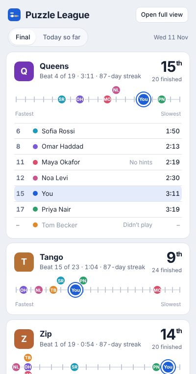
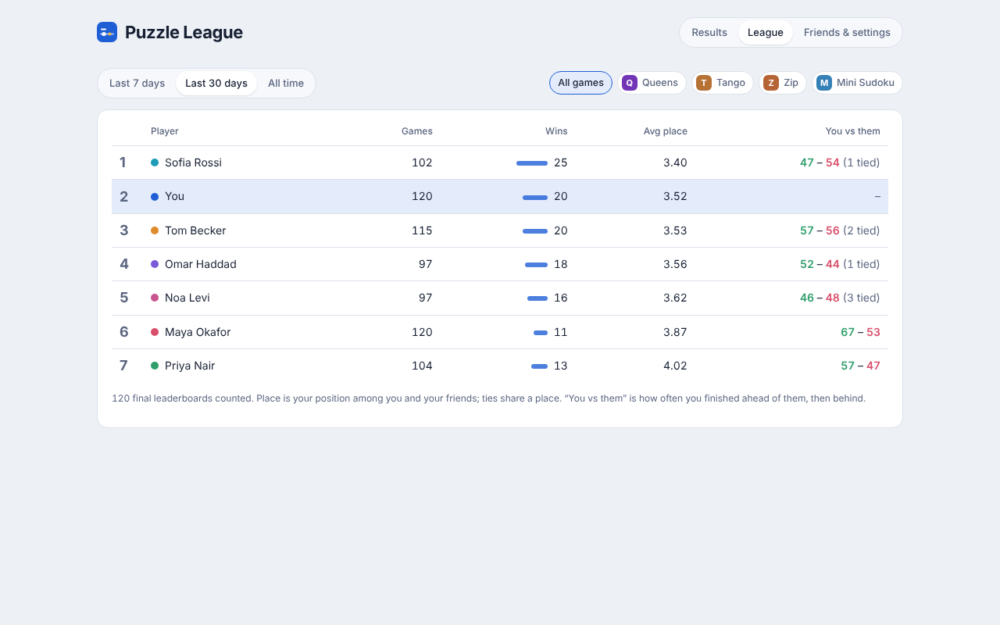

# Puzzle League

**Your final LinkedIn games results, every day, and a league table of the friends you choose.**

> Puzzle League is an unofficial, independent project. It isn't made, endorsed or supported by LinkedIn.

LinkedIn's games leaderboards keep changing all day, and they reset at midnight US Pacific time. Unless you check back just before the reset, you never see where you actually finished. If you want to know how you did against particular friends, you have to scroll the whole list.

Puzzle League fixes both. It saves the final standings for every game you play. It then shows your rank, and up to ten friends you pick, in a compact view that stays put.

## What it does

- **Final ranks, saved for you.** The first time you open a game's leaderboard each day, Puzzle League saves yesterday's final standings. It also keeps today's standings up to date as you look at them.
- **Your friends at a glance.** Pick up to ten people from your leaderboards. Each game shows the whole field on a single line from fastest to slowest, with you and your friends marked on it.
- **A league table.** Compare yourself with your friends over the last 7 days, 30 days or all time, for every game or one at a time. It shows wins, average place and your head-to-head record against each friend.
- **Your form.** A 14-day line for each game shows what share of the field you beat each day.
- **Gap filling.** If a day's final standings were missed, Puzzle League can quietly fetch them in a background tab (see [How it works](#how-it-works)).

## Install

### Chrome, Vivaldi, Edge or Brave

Install from the Chrome Web Store: **[link coming soon]**

To install it manually instead:

1. Download the latest `puzzle-league.zip` from [Releases](../../releases) and unzip it somewhere permanent. Your browser loads it from that folder, so don't delete it.
2. Open your browser's extensions page (`chrome://extensions`, `vivaldi://extensions`, `edge://extensions` or `brave://extensions`).
3. Turn on **Developer mode**.
4. Click **Load unpacked** and choose the unzipped folder.

### Firefox (version 140 or later)

1. Download the latest `puzzle-league.xpi` from [Releases](../../releases).
2. Drag it into a Firefox window, or open `about:addons`, click the gear icon and choose **Install Add-on From File**.
3. Allow it to access **linkedin.com** when asked. To check later, go to `about:addons`, open Puzzle League, then the **Permissions** tab.

## Getting started

1. Play your LinkedIn games as usual, then open each game's leaderboard (**See results**).
2. Open Puzzle League from the toolbar and click **Choose your friends**. Tick up to ten people.
3. From the next day, the popup shows your final rank for each game alongside your friends.

A game appears in Puzzle League once you've opened its leaderboard at least once.

## How it works

Puzzle League reads the connections leaderboard that LinkedIn already shows you. It doesn't use any LinkedIn API, and it never sees your password.

- **When you open a leaderboard**, it saves what's on screen. If yesterday's final standings for that game haven't been saved yet, it switches to LinkedIn's **Yesterday** tab for a couple of seconds, saves the full list, and switches back. A small confirmation note appears when it does this.
- **Gap filling** covers days you don't open the leaderboard. It's on by default and can be turned off in **Friends & settings**. It opens the leaderboard in a background tab, saves yesterday's final standings and closes the tab. To avoid ever starting a puzzle timer, it only does this once you've already played that day's puzzle, or on Saturday's puzzle day. It tries each game at most three times a day.
- **Puzzle days** run from midnight to midnight US Pacific time, matching LinkedIn's reset. Puzzle League works this out itself, so it stays right through daylight-saving changes in both the US and your own time zone.

## Privacy

- Everything is stored locally in your browser. Nothing is sent to the developer or anyone else.
- There are no analytics, accounts or servers.
- Your data stays until you delete it. You can export a backup, import one into another browser, or delete everything from **Friends & settings**.

### Permissions

| Permission | Why it's needed |
| --- | --- |
| Access to `linkedin.com` | To read the games leaderboards you open, and to open them in a background tab for gap filling. |
| Storage | To keep your results, friends and settings in your browser. |
| Alarms | To check for missing results every 30 minutes. |

## Limitations

- Friends are matched by their display name. If someone changes their LinkedIn name, tick them again.
- If LinkedIn redesigns the leaderboard page, results may stop saving until Puzzle League is updated. Please open an issue if you notice this.
- Gap filling needs your browser to be running. A day's final standings can only be saved until the next reset after that day ends.
- Game icons are loaded from LinkedIn. If they can't be loaded, a lettered tile is shown instead.

## Project structure

| File | Purpose |
| --- | --- |
| `manifest.json` | Extension manifest (Manifest V3, works in Chromium browsers and Firefox). |
| `shared.js` | Game list, puzzle-day date handling and storage helpers. |
| `parser.js` | Reads the leaderboard from LinkedIn's page. |
| `content.js` | Runs on LinkedIn: detects leaderboards, saves standings and handles the Today/Yesterday switch. |
| `background.js` | Saves and merges results, and runs gap filling. |
| `popup.html`, `popup.js` | Toolbar popup. |
| `dashboard.html`, `dashboard.js`, `dashboard.css` | Full view: results by day, league table, friends and settings. |
| `ui.js`, `styles.css` | Shared display components and styles. |

There's no build step. The files in this repository are the files that ship.

## Contributing

Bug reports are welcome, especially when LinkedIn changes something. If results stop saving, please open an issue with:

- your browser and version
- which game it was
- what you expected to see and what you saw instead

## Licence

MIT License

Copyright (c) 2026 Phil Schajer

Permission is hereby granted, free of charge, to any person obtaining a copy
of this software and associated documentation files (the "Software"), to deal
in the Software without restriction, including without limitation the rights
to use, copy, modify, merge, publish, distribute, sublicense, and/or sell
copies of the Software, and to permit persons to whom the Software is
furnished to do so, subject to the following conditions:

The above copyright notice and this permission notice shall be included in all
copies or substantial portions of the Software.

THE SOFTWARE IS PROVIDED "AS IS", WITHOUT WARRANTY OF ANY KIND, EXPRESS OR
IMPLIED, INCLUDING BUT NOT LIMITED TO THE WARRANTIES OF MERCHANTABILITY,
FITNESS FOR A PARTICULAR PURPOSE AND NONINFRINGEMENT. IN NO EVENT SHALL THE
AUTHORS OR COPYRIGHT HOLDERS BE LIABLE FOR ANY CLAIM, DAMAGES OR OTHER
LIABILITY, WHETHER IN AN ACTION OF CONTRACT, TORT OR OTHERWISE, ARISING FROM,
OUT OF OR IN CONNECTION WITH THE SOFTWARE OR THE USE OR OTHER DEALINGS IN THE
SOFTWARE.
